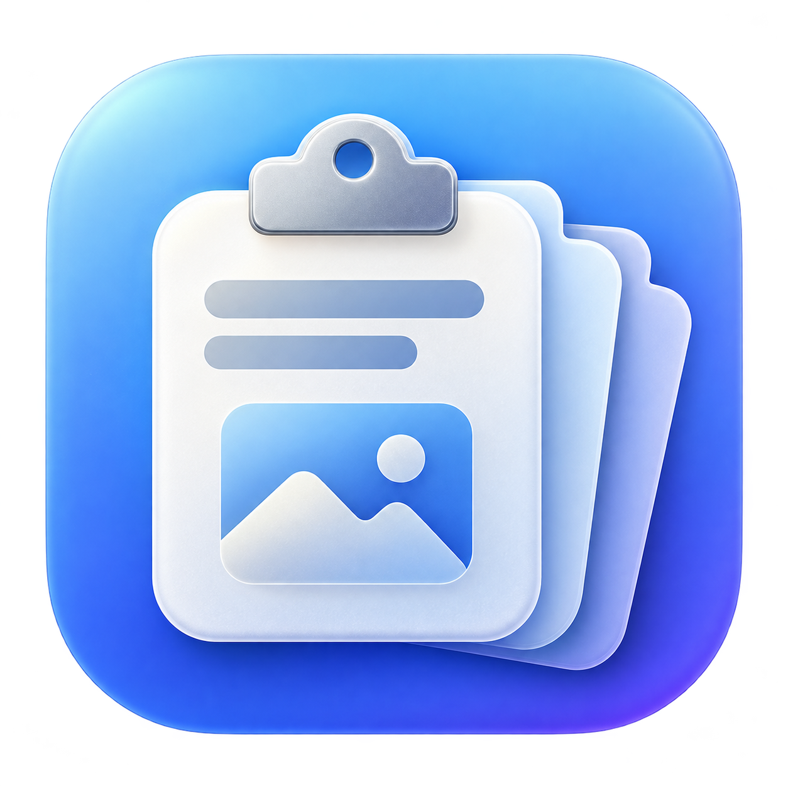

<div align="center">
  
  <h1>ClipboardHistory</h1>
  <p>Copiou, ficou. Seu histórico de textos e imagens a um atalho de distância.</p>
  <p>
    
    
    
  </p>
</div>

Um histórico de clipboard para macOS, inspirado na praticidade do histórico do Windows. Vive na barra de menus, guarda suas últimas cópias e traz de volta aquele texto ou imagem que você já tinha perdido no próximo Command + C.

## O que ele faz

| Recurso | Como funciona |
| --- | --- |
| Textos e imagens | Guarda até 100 itens, com prévia e data da cópia. |
| Atalho global | **Control + Command + V** abre o histórico. |
| Busca | Encontre rapidamente um texto copiado. |
| Colagem ao clicar | Volta ao aplicativo anterior e cola o item selecionado. |
| Janela flutuante | Destaque o histórico e mova-o pela tela. |
| Início automático | Ative **Iniciar sempre com o computador** nos ajustes. |
| Controle do histórico | Pause novas capturas, exclua um item ou limpe tudo. |
| Dados locais | O histórico fica no seu Mac, sem envio à rede pelo app. |

## Comece por aqui

Requisitos: **macOS 14 ou superior**, **Swift 6** e ferramentas de desenvolvimento do Xcode com o SDK do macOS.

```sh
git clone https://github.com/JVini0166/macos-history-clipboard.git
cd macos-history-clipboard
./scripts/build-app.sh
open dist/ClipboardHistory.app
```

O script compila a versão de produção, gera o ícone e monta o aplicativo com assinatura ad hoc para uso local.

Para instalar, feche o app caso esteja aberto, copie **dist/ClipboardHistory.app** para **Aplicativos** e abra essa cópia. Faça isso antes de configurar o início automático para manter o aplicativo em um local estável.

Para trabalhar no código, abra `Package.swift` no Xcode ou execute:

```sh
swift build
swift run
```

A opção de início automático fica disponível na versão `.app`.

## Copiar → escolher → colar

1. Deixe o ClipboardHistory aberto e copie um texto ou imagem normalmente.
2. Clique no campo do aplicativo em que deseja colar.
3. Pressione **⌃⌘V** ou clique no ícone de clipboard na barra de menus.
4. Busque e selecione um item. O app restaura o aplicativo anterior e envia **⌘V**.

**Enter** seleciona o primeiro resultado da busca. **Escape** fecha o histórico.

Na primeira colagem, habilite **ClipboardHistory** em **Ajustes do Sistema → Privacidade e Segurança → Acessibilidade**. Essa permissão permite simular Command + V. Sem ela, o item continua sendo copiado e você pode colar manualmente.

A colagem de imagens depende de o campo de destino aceitar imagens. O app disponibiliza PNG e representações nativas do macOS no clipboard.

## Uma janela que acompanha seu trabalho

Arraste o popover para fora da barra de menus ou use o botão de **setas** no cabeçalho. A janela destacada pode ser movida pela barra de título e permanece visível ao alternar entre aplicativos. Selecionar um item fecha a janela para devolver o foco ao destino.

## Iniciar sempre com o computador

Abra a **engrenagem** no cabeçalho e ative **Iniciar sempre com o computador**. O ClipboardHistory será aberto na barra de menus quando você entrar na sua conta do macOS.

Se aparecer uma solicitação de aprovação, clique em **Abrir Itens de Início** e autorize o aplicativo. O ajuste consulta o estado informado pelo sistema; desative a mesma opção para remover o início automático.

Essa integração usa [`SMAppService.mainApp`](https://developer.apple.com/documentation/servicemanagement/smappservice), da Apple.

## Privacidade e armazenamento

O histórico é salvo em:

```text
~/Library/Application Support/ClipboardHistory/history.json
```

- O arquivo tem permissões de leitura e escrita restritas ao usuário, sem criptografia própria.
- Conteúdos que o aplicativo de origem marcar como confidenciais, transitórios ou gerados automaticamente são ignorados. Conteúdos sensíveis sem essas marcações podem entrar no histórico.
- **Pausar** interrompe novas capturas. **Limpar** apaga os itens salvos, sem alterar o conteúdo atual do clipboard.
- O app não captura cópias feitas antes de sua abertura.

## Limites da primeira versão

- Até **100 itens**, **1 MB por texto** e **10 MB por imagem PNG**.
- A captura consulta o clipboard a cada **0,5 segundo**; cópias muito rápidas podem não ser registradas.
- Imagens são normalizadas para PNG. Arquivos, formatação rica e sincronização entre dispositivos não são suportados.
- O atalho pode conflitar com outros aplicativos ou configurações. Se o registro falhar, o app avisa e continua acessível pela barra de menus.
- O bundle local usa assinatura ad hoc. Distribuição pública requer preparação de assinatura e notarização.

## Estrutura do projeto

```text
Assets/                         Logo e prompt de geração
Sources/ClipboardHistory/
  main.swift                    Captura, histórico, interface e colagem
  SettingsView.swift            Ajustes e integração com Itens de Início
scripts/build-app.sh            Build, ícone e montagem do .app
Package.swift                   Pacote Swift, sem dependências externas
```
