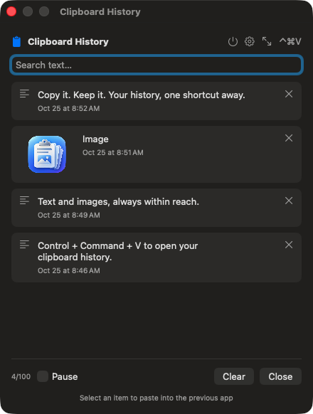
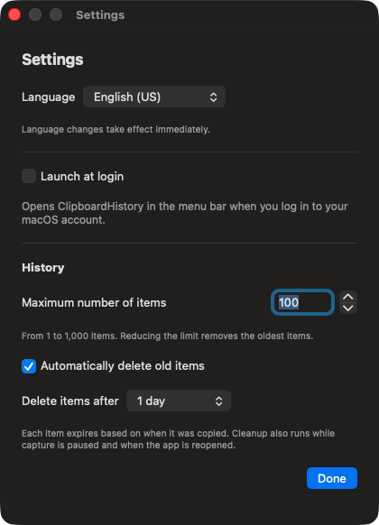

<div align="center">
  
  <h1>ClipboardHistory</h1>
  <p>Copy it. Keep it. Your text and image history, one shortcut away.</p>
  <p>
    
    
    
  </p>
</div>

A native clipboard history app for macOS, inspired by the convenience of Windows clipboard history. It lives in your menu bar and brings back the text or image you copied before your last Command + C.

## Features

| Feature | What it does |
| --- | --- |
| Text and images | Keep 1–1,000 items with previews and timestamps; 100 by default. |
| Global shortcut | Open history with **Control + Command + V**. |
| Search | Find previously copied text. |
| Click to paste | Return to the previous app and paste the selected item. |
| Floating window | Detach history and move it around your screen. |
| Launch at login | Start the app automatically when you log in. |
| Optional expiration | Delete items after 5 or 30 minutes, 1 or 6 hours, or 1, 7 or 30 days. |
| Two languages | Switch between **English (US)** and **Português (Brasil)** in Settings. |
| History controls | Pause capture, delete individual items, or clear everything. |
| Local storage | Clipboard history stays on your Mac; the app does not send it over the network. |

## Screenshots

Native app screens captured in a separate demonstration instance using sample text and the project logo. No personal clipboard content or preferences were used.

| Text and image history | Settings |
| --- | --- |
|  |  |

## Getting started

Requirements: **macOS 14 or later**, **Swift 6**, and Xcode development tools with the macOS SDK.

```sh
git clone https://github.com/JVini0166/macos-history-clipboard.git
cd macos-history-clipboard
./scripts/build-app.sh
open dist/ClipboardHistory.app
```

The build script compiles a release binary, generates the app icon, and creates an app bundle with an ad hoc signature for local use.

To install, quit any running copy, move **dist/ClipboardHistory.app** into **Applications**, and open the installed copy. Install it before enabling launch at login so the app stays in a stable location.

For development, open `Package.swift` in Xcode or run:

```sh
swift build
swift run
```

Launch at login is only available when running the `.app` bundle.

## Copy → choose → paste

1. Keep ClipboardHistory running and copy text or images as usual.
2. Click the destination field in the app where you want to paste.
3. Press **⌃⌘V** or click the clipboard icon in the menu bar.
4. Search and select an item. ClipboardHistory restores the previous app and sends **⌘V**.

**Enter** selects the first search result. **Escape** or **Close** hides the window while keeping the app running. To quit, use the **power icon** to the left of the settings gear.

For automatic pasting, enable **ClipboardHistory** in **System Settings → Privacy & Security → Accessibility**. This permission allows the app to simulate Command + V. Without it, selecting an item still copies it, and you can paste manually.

Image pasting requires a destination field that accepts images. The app provides PNG and native macOS image representations on the clipboard.

## A window that stays within reach

Drag the popover away from the menu bar or use the **arrows button** in its header. Move the detached window using its title bar; it stays visible when you switch apps. Selecting an item hides the window to return focus to the destination.

## Language

Open the **gear → Language** and choose **English (US)** or **Português (Brasil)**. Labels, tooltips, app alerts, and item dates update immediately, and the selection is saved for future sessions. Existing installations default to Brazilian Portuguese until you choose another language.

The language setting does not translate copied content. macOS-owned dialogs and system error details follow the operating system's language.

## Launch at login

Open the **gear** and enable **Launch at login**. ClipboardHistory will open in the menu bar when you log in to your macOS account.

If approval is required, click **Open Login Items** and authorize the app. The toggle reflects the status reported by macOS. Disable the same option to stop launching automatically.

This integration uses Apple's [`SMAppService.mainApp`](https://developer.apple.com/documentation/servicemanagement/smappservice).

## History capacity and automatic cleanup

Under **gear → History**, choose a capacity between **1 and 1,000 items**. The default is 100. Reducing the limit removes the oldest items.

**Automatically delete old items** is off by default. When enabled, choose **5 minutes, 30 minutes, 1 hour, 6 hours, 1 day, 7 days, or 30 days**. Each item expires based on when it was copied. Already expired items are removed when you enable cleanup or shorten the duration.

Cleanup continues while capture is paused. If the app is closed, expired items are removed the next time it opens. Cleanup does not change the current clipboard contents.

Preferences persist across sessions. Turning cleanup off preserves remaining items, subject to the selected capacity.

## Privacy and storage

History is stored at:

```text
~/Library/Application Support/ClipboardHistory/history.json
```

- The file is restricted to the current user's read and write access, with no app-level encryption.
- Content marked as concealed, transient, or automatically generated by its source app is ignored. Sensitive content without these markers can still enter history.
- **Pause** stops new captures. **Clear** deletes saved history without changing the current clipboard contents.
- The app does not capture items copied before it was launched.

## Current limitations

- **1–1,000 items** (100 by default), **1 MB per text item**, and **10 MB per PNG image**.
- Clipboard polling runs every **0.5 seconds**; rapid consecutive copies may be missed.
- Images are normalized to PNG. Files, rich text formatting, and device synchronization are not supported.
- The shortcut may conflict with other apps or settings. If registration fails, the app displays an alert and remains accessible from the menu bar.
- Local builds use an ad hoc signature. Public distribution requires appropriate signing and notarization. Rebuilding the app may require renewing its Accessibility authorization.

## Tests

```sh
swift test
```

Tests cover capacity, expiration boundaries, keeping items when cleanup is disabled, saved preferences, language persistence and fallback, and date formatting for both locales. Validate the complete app bundle with `./scripts/build-app.sh`.

## Project structure

```text
Assets/                         Logo, generation prompt, and screenshots
Sources/ClipboardHistory/
  main.swift                    Capture, history, interface, and paste behavior
  SettingsView.swift            Preferences and Login Items integration
  AppLanguage.swift             English and Brazilian Portuguese UI strings
  HistoryPolicy.swift           Capacity and expiration rules
Tests/ClipboardHistoryTests/     Retention, preferences, and language tests
scripts/build-app.sh            Release build, icon, and .app packaging
Package.swift                   Swift package with no external dependencies
```
